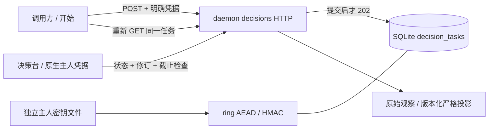

# SysTorch 持久人工决策契约与使用指南

状态：2026-10-29 本地候选实现，尚未提交或发布。当前持久人工任务支持个人主人处理一条消息中的 1–32 道 Noul、Choice、Score、Box 题，并使用加密资产表关联图片等媒体。团队分派、通知、人工来源接入 DAG 策略仍属后续阶段。持久人工通道独立于现有即时 `/v1/systemone` 调用；两者共用 TypeSafe-compatible 的 `model/state/questions` 领域形状。

**请求格式铁律**：SysTorch 是自有请求超集；核心字段沿用 TypeSafe `model/state/questions`，任务身份、幂等、截止时间、问题顺序、资产与命名扩展作为 SysTorch 加法字段。`Submission::jev_projection()` 丢弃任务生命周期字段并得到 Jev `model/state/questions` 子集；已有 `/v1/systemone` 仍是即时模型入口。旧 M1 `question/context/choices` 请求保留读取和重试兼容，并会按相同 TypeSafe 核心比较幂等身份；新客户端必须提交 `model/state/questions`。旧加密任务缺少的新观察映射默认为空，旧 Choice 答案仍可读取和提交。

## 一次真实使用

1. 打开 M1 原生测试应用，进入「开始」。本机网关启动后，应用经原生 RPC 读取主人凭据，不需要通过网关登录来获得它。
2. 当前入口选「交给我回答」，选择 Noul、Choice、Score 或 Box 类型并填写题目；可把多道不同类型的问题加入同一队列，一次提交。Choice 使用 2–255 个选项，Score 使用 2–10 个有序等级，Noul 使用是/否，Box 必须在本题或共享状态引用图片。题目可附图片、音频、视频或文件；共享上下文与单题附件保持各自归属。上下文可以是文字或 JSON，不会执行 HTML、脚本或抓取其中的 URL。
3. 点击「提交决策」。只有 SQLite 提交成功才显示持久接收与任务 ID。此时可以切页、关窗或退出应用；调用方不用保持 HTTP 连接。
4. 在「决策台」找到任务，阅读问题、上下文、候选、截止时间和修订号。点选仅修改草稿，「提交回答」才接受观察。忙碌期间禁用重复操作。
5. 可以附条件、拒答，或在原因框中填写问题后「请求补充信息」。只有原调用方可修订事实，主人不能擅自改写外部调用方的题目；修订保留原文和原截止时间，旧修订的迟到回答返回冲突。
6. 调用方查询同一 ID，取回原始观察或严格 Jev 答案。Choice、Noul、Score、Box 都按原题型映射；不匹配或无效答案整批回滚。完成内容默认保留 7 天；原生应用可明确导出单个任务的未加密 JSON。取消与清除内容都有独立确认，查看或关闭页面不触发这些动作。

「开始」也可选择已有模型入口，使用既有即时调用与路由追踪；不会在人工等待背后隐式调用模型。DAG、提供商启停、请求曝光与响应辉光、演练场、统计和仪表盘保留原入口。人工等待不是一个伪造的上游 HTTP attempt，不向路由图重播事件。

## 身份和权限

所有新 API 均须显式 `Authorization: Bearer …`，包括 loopback/local 模式。任务 ID 和来源 IP 都不是回答凭据。

本节只定义新人工通道。旧模型／配置控制平面继续使用原部署信任边界，不能据此宣称所有既有 API 都迁移成相同授权体系；本机模式也不是对抗同机恶意进程的隔离边界。

| 身份 | 提交 | 列出／读取／取结果 | 回答／请求补充 | 修订事实 | 取消／清除终态内容 |
|---|---|---|---|---|---|
| 启用的受管理调用 Token | 可以 | 仅该稳定 Token ID 的任务 | 不可以，包括 admin 角色 | 仅自己提交的 pending | 仅自己的任务 |
| 本机主人 | 可以 | 该数据目录全部任务 | 可以 | 仅自己提交的 pending | 可以 |
| 匿名、失效或撤销 Token、普通管理会话 | 不可以 | 不可以 | 不可以 | 不可以 | 不可以 |

主人凭据来自数据目录独立的 `systorch-owner.key`，仅本机受信任的主窗口可通过原生桥读取能力部分，HTTP 不提供获取它的免费接口。应用不会把本机主人凭据发给设置中的外部网关；地址或身份在等待期间改变，旧结果不能写回新身份界面。普通浏览器可输入受管理调用 Token，以调用方身份使用；主人的浏览器调试凭据只应由该数据目录的操作者自行提供，不应公开。

M1 接收的来源固定为 `human:owner`，它是这个持久通道的明确来源，不修改已有模型 DAG。回答者固定为 `local-owner`，不宣称这是已经完成的多用户账号或团队授权系统。

## HTTP 操作

前缀为 `/v1/systorch`。错误体为 `{"code":"稳定机器码","error":"不含正文和密钥的操作建议"}`。所有该通道响应设置 `Cache-Control: no-store`，前端同样禁用请求缓存，避免 WebView 磁盘缓存持有私人正文或重用旧权限结果。常规任务变更均为单任务动作，不支持整表覆盖。

| 方法与路径 | 用途／返回 |
|---|---|
| `GET /identity` | 当前稳定身份、能否回答、来源及留存窗口 |
| `POST /decisions` | 持久接收：新任务 202；同键同体重试 200、同一 ID |
| `GET /decisions?offset=0` | 当前身份可见的 25 条任务，pending 优先 |
| `GET /decisions/{id}` | 当前修订、历史修订、原始观察与投影策略 |
| `POST /decisions/{id}/answers` | 回答指定修订；相同回答重试返回原接受时间，冲突 409 |
| `POST /decisions/{id}/clarifications` | 指定回答者请求补充信息，不改写题目，不延长截止时间 |
| `POST /decisions/{id}/revisions` | 原调用方按修订号修改事实／候选，修订号递增 |
| `POST /decisions/{id}/cancel` | 明确取消 pending；同一取消可重试，其他终态冲突 |
| `GET /decisions/{id}/result` | pending 为 202；无条件回答为 200 严格 JevResponse；拒答／附条件为 422，取消／过期／内容已清除为 410 |
| `DELETE /decisions/{id}` | 清除终态正文，204；pending 必须先明确取消 |

一条消息无论包含一种或多种题型，都只发一次 `POST /decisions` 并获得一个任务 ID。新格式保留 TypeSafe-compatible `model/state/questions` 核心，`entry`、`idempotency_key`、`ttl_seconds` 和 `question_order` 是 SysTorch 扩展；媒体资产可通过相同引用表登记：

```json
{
  "model": "human:owner",
  "state": {
    "deadline": "今天下班前",
    "_systorch": { "assets": ["shared_image"] }
  },
  "questions": {
    "q-route": {
      "type": "choice",
      "instructions": "下一步应该走哪条路线？",
      "criteria": { "local": "本地", "cloud": "云端" }
    },
    "q-ready": {
      "type": "noul",
      "instructions": "本地服务是否已就绪？",
      "criteria": { "true": "已就绪", "false": "未就绪" }
    },
    "q-severity": {
      "type": "score",
      "instructions": "问题严重程度是什么？",
      "criteria": ["外观瑕疵", "有临时解决办法", "工作被阻断"]
    },
    "q-region": {
      "type": "box",
      "instructions": {
        "text": "标出图表中的峰值区域。",
        "_systorch": { "assets": ["chart_image"] }
      }
    }
  },
  "entry": "human:owner",
  "idempotency_key": "planning-message-001",
  "question_order": ["q-route", "q-ready", "q-severity", "q-region"],
  "assets": {
    "shared_image": { "type": "image", "format": "png", "mime_type": "image/png", "asset_id": "asset_shared" },
    "chart_image": { "type": "image", "format": "png", "mime_type": "image/png", "asset_id": "asset_chart" }
  },
  "ttl_seconds": 3600
}
```

调用方的媒体先通过 `/assets` 上传并登记；Box 题必须引用图片。`question_order` 保留聊天编辑器队列顺序。投影到 TypeSafe 时剔除 `entry`、`idempotency_key`、`ttl_seconds`、`question_order` 等任务字段，保留 `model/state/questions/assets`；`extensions` 仅在 adapter 明确支持时转发。旧 `question/context/choices` 字段仅为已存 M1 客户端兼容保留，不应由新客户端发送。Noul 以 `noul` 概率 1/0 表示人工布尔回答；Score 等级从 0 开始，人工选中某等级映射为该位置的分数及 one-hot 概率。模型请求不会因此被拆成每题一次调用。

### 脚本提交与查询

可直接运行、分两次进程使用的 PowerShell 示例见[外部调用实操](../guides/SYSTORCH-EXTERNAL-CHOICE.md)与[示例脚本](../../scripts/examples/choice-client.ps1)。它在请求发出前保存原始幂等键，退出后从本地回执恢复；不会把 Token 写入回执。

先进入「统计 → 访问与活动 → 调用 Token」创建一个调用 Token，复制一次显示的完整值，保存在脚本自己的安全环境中。本机 local 模式无需为此另设管理员密码；远端服务遵守原有管理授权。`GATEWAY` 是运行测试应用的地址；这里的 11436 是独立 M1 包默认端口。不要把上游供应商 API key 当调用 Token。

保存 `choice.json`：

```json
{
  "entry": "human:owner",
  "idempotency_key": "break-example-001",
  "question": "完成当前工作后，先休息还是继续？",
  "context": {"remaining_minutes": 20, "important": "这只是无害示例，不执行动作"},
  "choices": [
    {"id": "break", "label": "先休息十分钟"},
    {"id": "continue", "label": "继续完成当前小步骤"}
  ],
  "ttl_seconds": 3600
}
```

```bash
GATEWAY=http://127.0.0.1:11436
# CALLER_TOKEN 由操作者设置；不把真实值写入示例文件或日志。
curl -H "Authorization: Bearer $CALLER_TOKEN" -H 'Content-Type: application/json' \
  --data-binary @choice.json "$GATEWAY/v1/systorch/decisions"

# 将返回的 id 填入 TASK_ID。HTTP 断开不取消任务。
curl -H "Authorization: Bearer $CALLER_TOKEN" "$GATEWAY/v1/systorch/decisions/$TASK_ID"
curl -i -H "Authorization: Bearer $CALLER_TOKEN" "$GATEWAY/v1/systorch/decisions/$TASK_ID/result"
```

网络失败时，使用原文件和原幂等键重试，不要生成新键。作用域为「稳定调用方 ID + entry + key」；JSON 对象键顺序不影响摘要，数组顺序、内容及 TTL 的改变会冲突。初始提交摘要不会被后续事实修订覆盖，重试原提交返回这个任务的最新状态。新任务应换新键。建议使用不含私人内容的随机键。

主人通常在 UI 回答；旧单题可使用下面的请求体。普通选择可附带可选的 `note` 备注，原始观察保留它，严格结果不携带备注。需要脚本回答时须由操作者提供主人能力，而非拿普通 admin Token 冒充回答权限：

```json
{"revision":1,"observation":{"kind":"answered","choice_id":"break"}}
```

将此 JSON POST 到 `/decisions/{id}/answers`。其他观察为 `{"kind":"declined","reason":"依据不足"}` 或 `{"kind":"conditional","choice_id":"break","condition":"先保存文件"}`。条件／拒答不是异常丢失的选择，不会自动换源寻求同意。

多题任务也可单独提交一个答案：`{"revision":1,"question_id":"question-1","observation":{"kind":"answered","choice_id":"option-2"}}`。或一次原子提交多题：`{"revision":1,"observations":{"question-1":{"kind":"answered","choice_id":"option-2"},"question-2":{"kind":"answered","choice_id":"option-1"}}}`。键必须是该任务里的稳定问题 ID；同一题重复相同观察幂等，换成不同答案返回 409。多个答案中任一字段无效时整次提交不写入。只回答部分题时任务保持 `pending`，所有题都有观察后才进入 `completed`。

请求补充：`{"revision":1,"question":"当前工作是否已经保存？"}`。事实修订仍保留旧 M1 单题 API，并只向原调用方开放；多题任务及新 `model/state/questions` 请求当前拒绝单题式修订，需重新提交整条消息，避免 question ID 与观察映射错位。`extensions` 是唯一明确的扩展命名空间；不认识的顶层字段仍拒绝。

## 状态、并发与派生语义

`pending → completed / cancelled / expired`，终态不可重新打开。`completed` 中另外保存 answered／declined／conditional 原始观察，不把拒答变成执行失败。暂存点选、关闭详情和静音不属于任务终态动作。

SQLite 单写事务内检查状态、修订和截止时间，再保存一份或多份原始观察。多题批次先校验全部问题 ID、候选和观察，再一次性更新加密载荷；错误输入不会留下部分答案。多设备重复提交同一问题的同一观察得到同一接受结果；不同观察只有第一方成功，后来者收到 409。修订不会延长 deadline；回答恰好到 deadline 时也被拒绝。截止时间按网关 UTC 墙钟计算；重启后再次读写前会应用过期判定，不依赖某个 HTTP future 或 UI 计时器存活。

人工投影按题型生成 Jev `answers`，并按输入 question ID 返回：Choice 为所选项的 one-hot 分布；Noul 为 yes/no 的 1/0；Score 使用官方零起始有序等级，人工选中的 index 成为 score，legend 保留原等级描述；Box 保留 `[0,1]` 归一化坐标及严格的 top<bottom、left<right。Choice/Score 的 `confidence=1` 表示输出分布确定，不代表校准后的模型置信度或事实正确率。拒答或附条件不投影成答案，严格结果返回可读 422，原始观察仍可从任务读取；不会把条件回答静默改成同意。兼容结果 `upstream_calls=0`、费用与模型延迟为 null，不伪造 token 或供应商调用。TypeSafe 的 Score 分值由有序等级的 0 起始位置构成，官方说明见[Score primitive](https://docs.typesafe.ai/primitives/score)。

HTTP 连接超时、决策 deadline、终态内容留存是三个不同边界。M1 不持有长连接等待人回答，也不把轮询连接的取消当作任务取消。未提交草稿仅驻留窗口内存，导航可保留，完整应用／页面重启不会恢复草稿；**已经接受的任务和回答**由数据库恢复。

## 隐私、备份和容量

- 题目、上下文、候选、修订、补充问题及观察使用 ring AES-256-GCM 加密，随机 nonce，任务 ID 绑定为认证附加数据。幂等键和内容摘要采用带密钥 HMAC，数据库中不保存这些请求字段的明文。元数据仍包含 ID、归属、来源、状态、修订与时间。
- 密钥文件内同时有独立主人能力。Unix 创建权限为 0600；Windows 依赖用户数据目录 ACL。这里保护的是数据库单独泄露／备份的载荷，不声称能抵抗已获得同一用户账户／进程访问权的攻击者。不要公开密钥文件，也不要把数据库与密钥一起放进公开支持包。
- 密钥文件位于当前 `providers.toml` 同目录，数据库默认也在此处。若为 headless daemon 显式设置了 `JEV_SWITCH_DATA_DIR`，数据库可能另存，备份必须同时保留数据库目录与配置目录中的主人密钥；不能只复制其中一处。
- 备份时先完整退出测试应用／停止它持有的 daemon，再将数据目录里的数据库、残留 WAL／SHM 和主人密钥一起保存在受保护位置。恢复同一整套后再启动。已有任务时缺少或不匹配密钥会阻断人工任务的读取和接收，不自动生成新密钥掩盖丢失；旧即时模型网关保持可用，恢复配套密钥后可继续读原结果。已有设置 JSON 备份仍只包含配置，不是任务备份。
- 单任务导出是用户主动选择的**明文 JSON**，包含私人内容；界面先明确确认，Android 使用已有原生文件导出桥。清除是应用层内容删除，不承诺擦除既有备份或存储介质上的历史字节。
- 终态正文保留 7 天，在后续访问／维护时清除；pending 不按列表条数驱逐。清除后仍保留最小幂等墓碑，重复 key 返回 410，不复活已处理请求。最长等待为 7 天，单个提交上限 64 KiB，修订历史上限 256 KiB，2–32 个候选。
- 当前个人队列总容量 10,000 条（含墓碑）。满时 429，接收前拒绝，不驱逐已有任务。长期归档／压缩和多工作区管理不伪装成 M1 已完成能力。

## 排错

| 现象／机器码 | 原因与处理 |
|---|---|
| `decision_auth_required` 401 | 未提供明确凭据／Token 被撤销；原生应用先启动本包网关再刷新；浏览器检查调用 Token |
| `answer_not_assigned` 403 | admin 角色不等于回答者；使用指定主人 UI |
| `decision_not_found` 404 | ID 不存在或当前调用方无权限；不向其他调用方泄露存在性 |
| `idempotency_conflict` 409 | 同键换了提交内容；重试原请求，或明确创建新任务 |
| `revision_conflict` / `decision_closed` 409 | 事实已修订、别人已回答／取消或 deadline 到达；刷新权威状态再操作 |
| `conditional_not_projectable` / `decision_declined` 422 | 读取原始观察并由调用方显式处理，不应作为随机重试／换源条件 |
| `decision_erased` 410 | 内容已清除，墓碑仍在；不要复用旧 key |
| `decision_storage_unavailable` 500 | 磁盘、事务提交或密钥配套问题；检查空间和本包数据目录，恢复配套备份；不要贴出密钥 |
| 状态仍 pending，但窗口已关 | 这是设计行为；调用方继续查询，或明确取消 |
| `invalid_decision_json` 422 / `decision_too_large` 413 | 核对 JSON 字段、题型参数和内容上限；新请求需完整提供 `model/state/questions`，旧单题 Choice 信封仍可兼容 |
| `box_requires_image` 422 | Box 题必须引用本题或共享 `state` 中的图片；选择或上传图片后重新提交 |
| `answer_type_mismatch` 422 | Observation 必须与该 question ID 的 Noul/Choice/Score/Box 类型匹配；整批不写入，修正后仍可用原 revision 重试 |
| `score_level_out_of_range` / `invalid_box_coordinates` 400 | Score 等级使用从 0 开始的合法 criteria index；Box 坐标必须为 0–1 且上/左边小于下/右边 |

## 证据与边界

### 实现定位



`rs/crates/systorch-daemon/src/decisions/` 分开 HTTP 身份/合同、SQLite 状态动作和密钥文件/加密。迁移 009 只新增 `decision_tasks` 及队列索引：稳定 ID、caller/entry、幂等与载荷摘要、状态、修订、三个时间字段和密文。它不修改既有调用记录，也不把提供商密钥放进任务。数据库连接的同步互斥和 `BEGIN IMMEDIATE` 共同包住检查与写入；没有等待人类的锁或挂起上游 future。

`ui/src/pages/DecisionPage.tsx` 负责开始、收件/回答与事实修订，`ui/src/api/decisions.ts` 统一凭据及地址/身份变更检查。Rust 结构通过 ts-rs 导出。`src-tauri/src/decision_owner.rs` 检查主窗口、来源和本壳实际持有的网关端口，capability 文件显式授权自有页面；不能靠扩大任意远程原生权限解决连接问题。Android 系统栏/键盘 inset 在原生根视图消费一次，避免 CSS safe-area 为零时遮住新首页。

Windows 主窗口在运行时 Ready 阶段明确创建；隐藏创建期间不请求 WebView 焦点，显示后再聚焦。Android 首屏对只读原生状态使用有期限的就绪握手，避免过早丢失的回调永久阻塞渲染；它不会重放提交／作答等写操作。首屏仅用本机字体回退，不因第三方字体网络不可达而等待。

以[多模态与候选核验](../verification/systorch-assets-2026-10-29.md)及其候选哈希为准。该记录包含一次经授权的真实 TypeSafe 四题+合成图片调用；它不等于完整的 Android 原生附件测试。Playwright 浏览器视口不是 Android 真机验收，原生模拟器也不能替代维护者设备。旧 DAG／提供商生命周期保留既有实现和专项回归。

## 10. 当前实现边界与后续工作

- 持久人工端点已接受 TypeSafe-compatible `model/state/questions` 核心及 `entry/idempotency_key/ttl_seconds/question_order/assets/extensions` 加法字段；旧 M1 `question/context/choices` 仍可读取和以相同语义幂等重试。新代码不允许因旧镜像字段与核心字段不一致而猜测优先级。
- 单题与 1–32 题任务均在单一父任务中加密保存，支持四种题型、逐题或原子批量回答；已测类型错配、越界 Score、Box 坐标和 Box 缺图拒绝。`/result` 输出严格 JevResponse；拒答/附条件仍通过原始任务观察读取，不转为假答案。
- 媒体统一资产 API 已做加密存储、所属调用方授权、任务链接、配额/过期和读取范围；TypeSafe 官方仅投影 PNG/JPEG 图片，Box 缺图会在上游发送前报格式错误。官方音视频真实模型能力和 Android 原生相机/相册授权还未验证。
- 普通模型聊天现在使用独立的加密会话记录、CAS revision 和消息追加 API；成功响应、调用失败、问题顺序和长期附件可恢复，不写入 `call_logs` 正文。接口与迁移边界见[契约 10](10-SysTorch开始会话契约.md)。即时推理仍使用 `POST /v1/systemone`，不会为了持久化改变上游 Jev/TypeSafe wire shape。
- 还需完善音频/视频实际兼容服务验证、转换 trace 深化、Agent API 描述和 Android 真机附件/权限流程。持久人工任务、普通会话、TypeSafe 投影和调用历史仍是不同数据边界；参见契约 10。
- 旧 M1 加密任务、主人密钥、幂等墓碑、条件回答、截止时间和重启恢复是兼容基线，不能因协议升级而丢失。候选仍按本地工作树和对应 EXE/APK 哈希验收，不等于正式 Release。
