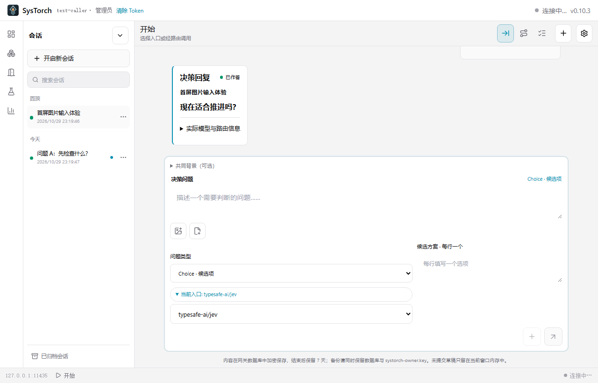
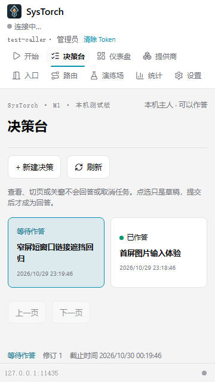
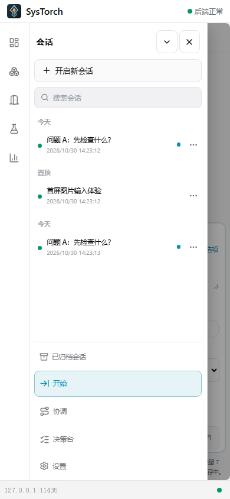

# SysTorch 图册 / Product gallery

[简体中文](#简体中文) · [English](#english)

## 简体中文

这些图片来自 2026-10-29 的本地浏览器预览，使用自动化测试夹具和合成请求。它们用于展示 SysTorch「开始／决策台」的交互方向，**不是 0.12.0 EXE 或 APK 的版本截图**，也不代表真实模型输出、真实调用 Token 或人工验收结果。

### 开始：结构化问题与会话

### 决策台：持久人工作答

### 触屏会话抽屉

火炬 SVG 母版为 [ui/src/brand/systorch.svg](../../ui/src/brand/systorch.svg)。当前预发布包身份、构建哈希和人工验收边界见[0.12.0 核验记录](../verification/v0.12.0-pre-release-2026-10-30.md)。

## English

These images are local browser previews captured on 2026-10-29 with automated fixtures and synthetic requests. They illustrate the Start / Decision Desk interaction direction. **They are not screenshots of the 0.12.0 EXE or APK**, and they do not represent real model output, real caller credentials, or hands-on acceptance.

### Start: structured questions and sessions

### Decision Desk: durable human answer

### Touch session drawer

The canonical torch SVG is [ui/src/brand/systorch.svg](../../ui/src/brand/systorch.svg). Build identity and hands-on acceptance boundaries for the pre-release are in the [0.12.0 verification record](../verification/v0.12.0-pre-release-2026-10-30.md).
