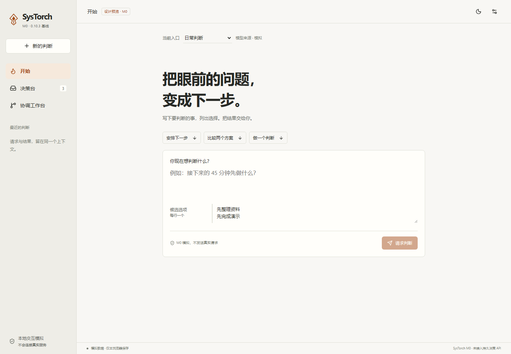
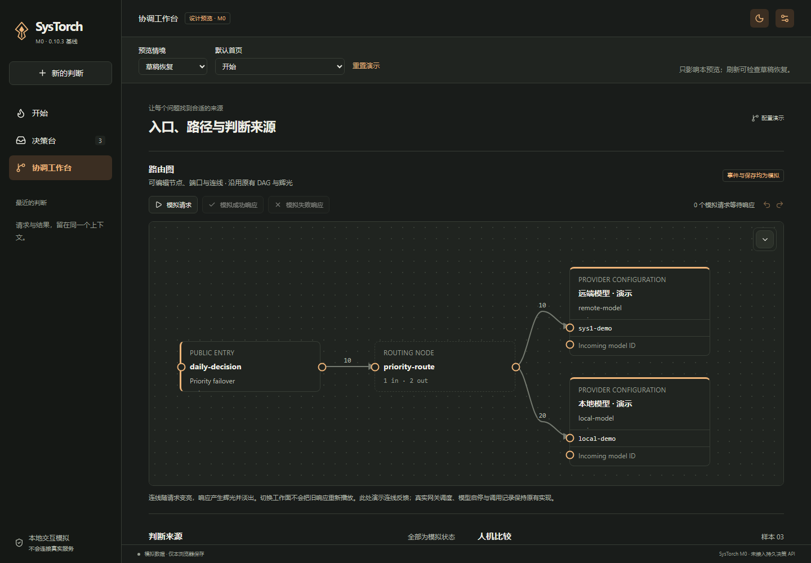

# SysTorch M0 本机核验与预览候选

> 2026-10-24 · OpenAI Codex 协助实现与核验。状态：`M0_LOCAL_PREVIEW_READY_FOR_REVIEW`。基于 `11253af` 的未提交工作树，版本字段仍为 `0.10.3`。没有新 worktree、提交、推送或发版。

本轮完成维护者授权的基线核验、路由编辑意图/并发发布修正，以及三个工作面的隔离状态原型。新的人类决策 API/数据库尚未实现，不把模拟反馈或历史原生验收当作新产品通过。完整数据和源文件哈希见[机器记录](systorch-m0-2026-10-24.json)。

## 预览入口

[打开本机交互预览](http://127.0.0.1:5173/systorch-preview.html)。Vite 只监听本机；右上角打开情境选择，可体验正常、无入口、加载、忙碌、断网、过期、冲突、拒答、条件、失败、草稿、权限与本地服务未启动。

协调工作台复用原有可编辑 DAG 与辉光渲染器，支持手动模拟请求/响应、图编辑与撤销。本地来源可模拟启动和停止；不会运行真实脚本。正式提供商、入口、图、演练场与统计仍保留原实现。详情见[工作面与状态合同](../design/SYSTORCH-M0-NAVIGATION-AND-STATE.md)。

[手机开始](assets/systorch-m0-2026-10-24/start-390.png) · [手机决策台](assets/systorch-m0-2026-10-24/desk-390.png) · [生产路由编辑器冲突恢复（mock API）](assets/systorch-m0-2026-10-24/route-conflict-recovery.png)

## 原子意图与并发修正

- UI 从自己的编辑基线生成边操作，update/delete 附带原值；不再把最新全表与旧草稿比较来推导删除。其他会话添加的边会进入回执与本地文档。
- 保存期间的新编辑继续保留；历史快照同步吸收远端未触及变更，撤销/重做不会顺手删掉别人的边。后续编辑与回执冲突时保留旧前提，不能悄悄取得覆盖新值的资格。
- 冲突可以载入最新并留下只读草稿备份；没有基线的旧格式草稿也只保留供核对，不自动当作整表意图应用。
- 共同配置门覆盖 provider、路由、入口、生命周期配置、主机命令、导入/导出及相关 TOML 设置的读改写和发布。状态探测前释放门；不串行化推理请求。
- provider/边成对发布；路由投影的 SQL 读取在提交前准备，正常提交后不再做可能失败的数据库刷新。停用入口的边可以编辑和保存，但不进入可执行路由。
- 原值冲突、写入失败及取消等待后，旧快照/运行投影保持，后续写入仍可继续。新增 SQLite 失败注入和多入口并发回归。

此保障限于一个 daemon 的管理写入/发布顺序，不是跨进程写锁，也没有新增整笔在途推理的配置冻结或全局 ETag 服务。协议见[HTTP 契约](../contracts/05-HTTP契约.md)。

## 自动门禁

| 检查 | 结果 |
|---|---|
| 修改前 Rust workspace | 277 通过，0 失败，1 个既有忽略项 |
| 最终 Rust workspace | 282 通过，0 失败，1 个既有忽略项 |
| 最终 Rust + ts-rs | 361 通过，0 失败，1 个既有忽略项 |
| 修改前 UI | 69 通过，0 失败 |
| 最终 UI | 82 通过，0 失败 |
| cargo fmt --check | 通过 |
| cargo clippy --workspace --all-targets -- -D warnings | 通过（默认 features） |
| UI lint / 生产 build | 通过；生产入口未接入新工作面，预览 HTML 不在默认发行输出 |
| Playwright 原型 | 20 组检查通过，0 页面异常、0 真实 API/外部请求 |
| Playwright 生产 RoutingPage | 4 条流程通过，全部 HTTP API 为 mock |

Rust 的既有忽略测试未被自动启用；ts-rs 对既有 serde 属性的解析提示仍存在，不是新增行为失败。没有把生成类型门禁当成真实 SDK 兼容验收。

浏览器覆盖：1440×1000、1024×800、390×844、360×640，浅/深色，13 个情境 × 三工作面；另检验桌面/手机 10%、100%、137%、200% 缩放的壳层高度与横向边界。包含 reduced-motion、原生 radio 选择、触摸视口、IME/连按、取消后迟到结果、断网草稿、权限、默认首页与实验返回。并未据此宣称真机多点手势或原生生命周期通过。

原型复用 DAG 的检查包括：并发模拟请求持有亮度，响应产生辉光，随来源时间衰减，切页返回不重新发光。七项专业功能链接另开原控制台，点击前不会连接其网关。生产路由编辑器流程覆盖：远端新增、撤销保留远端边、保存期间继续输入、冲突后备份/查看最新。生产 UI 的既有外部字体请求被测试拦截；新原型没有这类请求。

## 隔离运行与资源基线

`scripts/verify-isolated-gateway.mjs` 使用全新的配置/SQLite 和本机合成 TypeSafe-compatible HTTP 服务。三轮进程启动/重启，每轮 20 次，合计 60 次；真实模型调用为 0。检查请求成功、实际 adapter 归属、非法输入不派发、旧整表 PUT 405、过期原值 409、配置重启恢复及端口释放。三轮都由测试终止它所拥有的子进程再重启，验证受控中断后的恢复，不证明托盘 graceful exit 或原生关闭流程。

| 轮次 | 启动到 health | 本机合成请求 P95 | daemon 内存快照 |
|---|---|---|---|
| 1 | 883.7 ms | 16.1 ms | 21.15 MiB |
| 2 | 43.9 ms | 24.9 ms | 20.91 MiB |
| 3 | 43.5 ms | 16.6 ms | 21.00 MiB |

这里是单机 debug 构建、合成上游、每轮 20 次的小样本；启动探测含轮询量化，主机存在其他工作负载。它不是正式版性能承诺、前后优化对照、真实推理延迟或 Private Bytes/峰值测量。Tauri shell/WebView 指标仍为 unavailable，Android 未在本轮重装或重测。

隔离 EXE SHA-256：`56db01b3c364b308c7f14361646eed0b468b04ff4e742952e069238d60e402cd`。health 的 build_revision 为空，因此以该二进制哈希、工作树基线及源文件清单限定身份，不能称为已签名发行候选。

## 保留与未完成边界

- 原生窗口/托盘、Android service/tile/通知/签名沿用旧版具名人工证据；本轮没有伪造新的原生通过。
- 真正持久的人工请求、逐任务作答授权、strict/增强结果、跨设备提交与服务器恢复仍待 M1。24 项正式新服务验收仍保留 NOT_RUN，原型覆盖不自动改变其状态。
- 原型盲答只演示显示时机，不是服务端防作弊隔离；M3 必须从响应内容和权限上验证。
- 新视听母版、英文完整文案、品牌/包 ID/数据目录迁移和发布仍待后续。当前样式仅为设计评审候选，Agent 视觉检查不代替维护者审美确认。
- Vite 预览服务保留供维护者查看；隔离 daemon、合成服务与自动浏览器已退出。临时日志/隔离数据位于被忽略的 `.tmp/m0-20261024/`，保留便于复查。

## 接管与下一步

Agent 接管审阅：下一步 M1 应在独立 daemon 决策编排/存储模块接入真实任务，不改变冻结 adapter trait；前端以真实查询/提交状态替代模拟 reducer，保持选择/草稿/修订/接收/取回边界。图编辑使用同一意图事务与共同发布门，不为新页面另建全表保存路径。

当前停在 M0 预览评审。W21 的新一轮真实任务/竞品比较与普通人可用性研究没有在本轮执行，不用设计概念的认同替代采用证据。后续推进由维护者新指令决定。
